<picture>
  <source media="(prefers-color-scheme: dark)" srcset="docs/media/lefebvre-banner-dark.svg">
  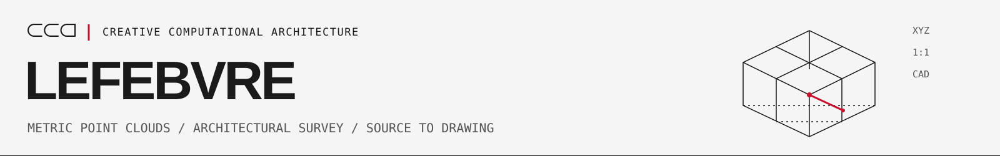
</picture>

<a href="LICENSE">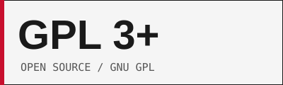</a>


*English | [Turkce](README.tr.md)*

[](LICENSE) [](#try-it) [](#architecture) [](docs/METHOD.md)

**A native point-cloud workstation for architectural survey: inspect the capture, review the geometry, and carry the evidence into CAD.** Lefebvre brings scan placement, height and projection views, plan candidates, survey sheets and drawing exports into one workspace. The original capture stays separate from the derived interpretation.

> **The code is open source under [GPL-3.0-or-later](LICENSE).** The examples and figures below show the application and its calculated outputs. Survey results remain **SURVEY DRAFT / UNCALIBRATED** until reviewed and independently checked.

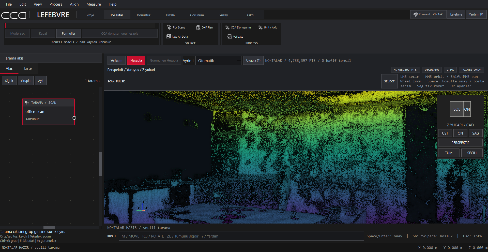

**Start from the captured room.** Captures contain furniture, interrupted wall evidence and uneven coverage. Lefebvre makes those conditions visible while giving the operator a route from points to architectural drawings. We are opening the source so that the conversion, assumptions and failure cases can be examined and improved. Issues, reproducible examples and contributions are welcome.

> **Authors / Context** - Creative Computational Architecture - Caglar Celik Architects (CCA), with Codex assisting release preparation and review. *"Redefining space through computation"* - a design praxis studio working across analysis, mathematics, art, geometry, philosophy, aesthetics, architecture and technology.
>
> [Instagram @caglarcelikarchitects](https://www.instagram.com/caglarcelikarchitects) | [caglarcelik.works](https://caglarcelik.works)

---

## From the office capture to drawings

The main walkthrough uses a bounded upper-room region of the studio's own office. The cutaway view exposes the captured geometry; its boundaries describe that selected region, not the full office footprint. These reviewed images show the native workspace and derived geometric evidence. The original scan, acquisition photographs, project files and real CAD export are kept outside this repository.

| Analysis | CAD preview |
|---|---|
| 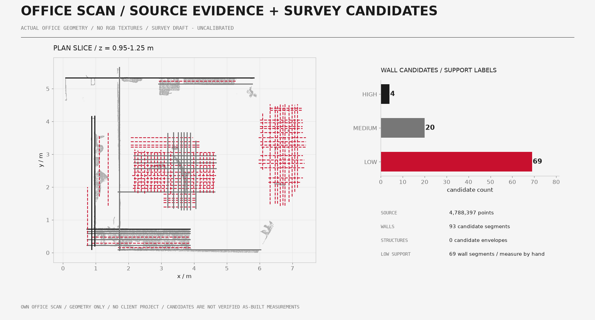 | 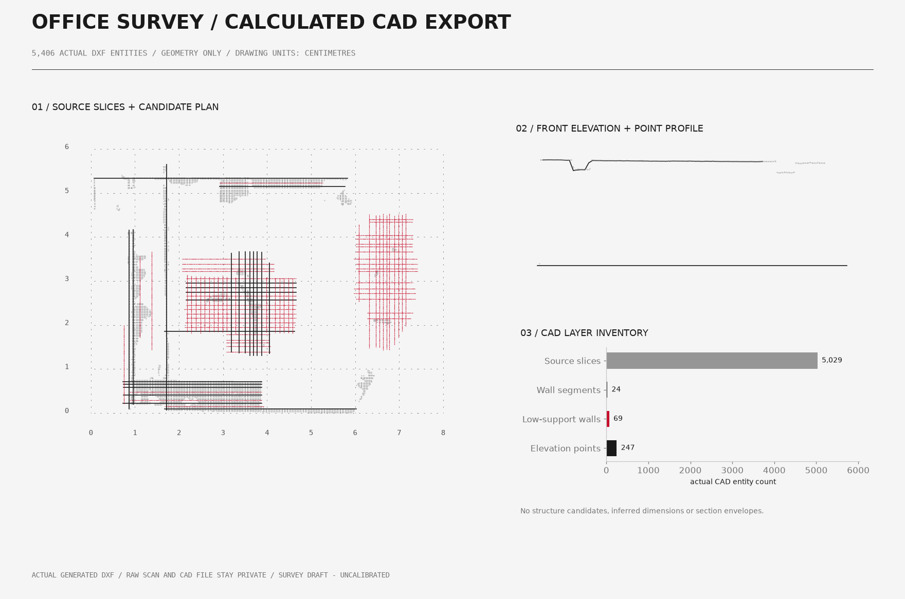 |
| **Read the support.** Inspect the point distribution and the geometry proposed by the survey pipeline. Support labels help the operator review each candidate. | **Inspect the drawing.** The preview shows the actual exported point projections and wall-candidate layers. This clipped interior returns no structure candidates or inferred dimensions; elevation, section and dimension examples appear in the separate mathematical benchmark. The real office CAD file is not distributed. |

The imported input is a processed XYZ PLY with 4,788,397 finite points; vendor acquisition data was converted privately before import. The public application does not decode the vendor's LiData format. The illustrated survey uses `source_axis="CAD_Z_up"` and an explicit 1.0 m minimum wall length. It returns **93 wall candidates: 4 HIGH, 20 MEDIUM and 69 LOW**, including furniture and interrupted surfaces that need review. The private DXF contains 5,406 entities and reopens with zero audit errors. No structure, dimension or section entities were inferred for this clipped interior.

The office walkthrough has no independent control survey and supplies no numerical accuracy claim. The mathematical benchmark below is a separate experiment with a known input.

## Try it

Use Python 3.12 on 64-bit Windows with a working OpenGL graphics driver. The application starts with an empty workspace.

```powershell
git clone https://github.com/creative-computational-architecture/cca-lefebvre.git
cd cca-lefebvre
py -3.12 -m venv .venv
.\.venv\Scripts\python.exe -m pip install --upgrade pip
.\.venv\Scripts\python.exe -m pip install .
.\.venv\Scripts\python.exe -m viewer.desktop_app
```

For a first run without a real scan, generate the mathematical survey example and open it:

```powershell
.\.venv\Scripts\python.exe examples/synthetic_survey.py --output generated/survey-demo
.\.venv\Scripts\python.exe -m viewer.desktop_app --project generated/survey-demo/input/demo.ccapoints.json --calculate-points --frame-scans
```

Inside the application, select the scan and open **Cikti > Otomatik Rolove** for the automatic survey pack, or **Cikti > Yuzeyden Plan + Gorunus** for the projection workflow. The generator has already run the same survey service with the benchmark settings documented in [METHOD.md](docs/METHOD.md). The native UI uses Turkish ASCII labels.

The installed command is `cca-lefebvre`. See [BUILD.md](BUILD.md) for tested dependency versions, native-window verification and package builds.

## What you can do with it

- **Inspect the capture.** Open a project, import point-cloud evidence, select scans, control visibility, and compare perspective, top, front, height and confidence views.
- **Place scans deliberately.** Review transformations and alignment candidates, keep scale explicit, and apply or undo a chosen placement.
- **Develop a plan.** Use the projection workflow to inspect slices and proposed architectural elements before interpreting them as walls or openings.
- **Build a survey pack.** Estimate a survey frame, derive supported wall runs and structure candidates, and produce plan, elevation, section and slice sheets.
- **Export drawing evidence.** The survey pack writes DXF layers, dimensions and numerical candidate files. Low-support geometry remains distinguishable.
- **Keep the source authoritative.** Property-preserving PLY transforms write derived files; the synthetic benchmark also checks the input hash before and after the survey.

The generic measurement commands, standalone DXF menu entries and individual ICP menu entries are not presented as completed workflows. ReCap/Revit interoperability is outside the verification described here.

## The native survey workflow - synthetic input

These are captures of the actual desktop application using the generated two-bay room. They show the working controls, projection panel and candidate list.

| Inspect and display | Develop the drawing |
|---|---|
| 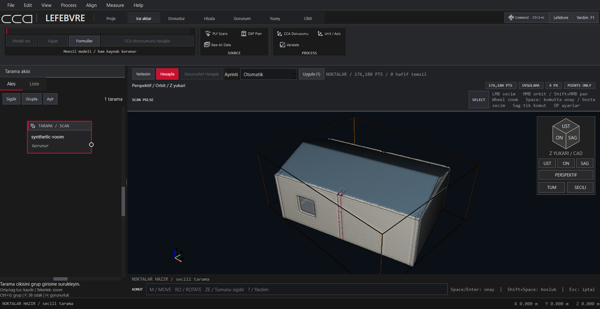 | 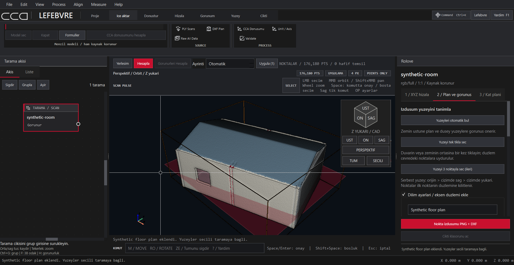 |
| **Point evidence.** The workspace displays 176,180 points with scan visibility, selection and camera controls. | **Plan and elevation.** Define a projection surface, inspect the plane and use the panel's PNG + DXF output route. |
| 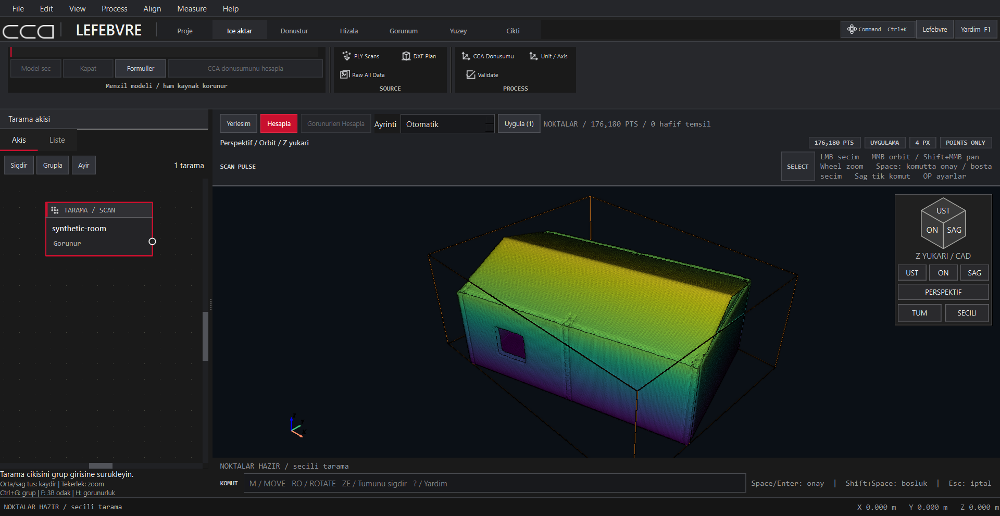 | 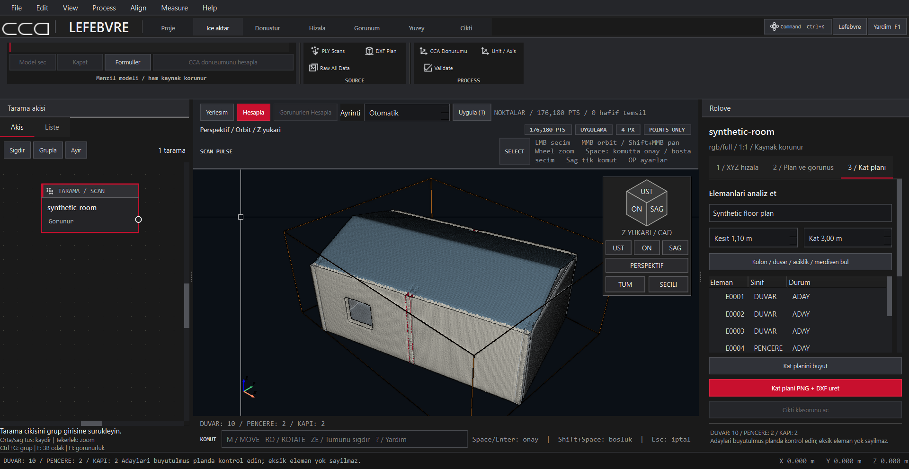 |
| **Height view.** Read the room's vertical distribution directly in the viewport. The colour display leaves the source geometry intact. | **Review candidates.** This interactive run reports 14 elements: 10 wall, 2 door and 2 window candidates. Their status is ADAY (candidate). |

The interactive plan detector is separate from the automatic survey pack's 10 wall segments below. Its opening candidates remain unvalidated. Open the [enlarged native plan preview](docs/media/08-native-plan-preview.png) to inspect the projected result.

## A separate mathematical benchmark

The benchmark is a generated two-bay room, rather than a scan of the office. It contains an 8.00 x 5.00 m interior, 0.18 m walls, a 3.00 m eave and a 3.80 m ridge. The generator adds a 17-degree source yaw and deterministic Gaussian noise to 176,180 points. It reads no photographs, customer projects or external datasets.

| Calculated survey evidence | Drawing evidence |
|---|---|
| 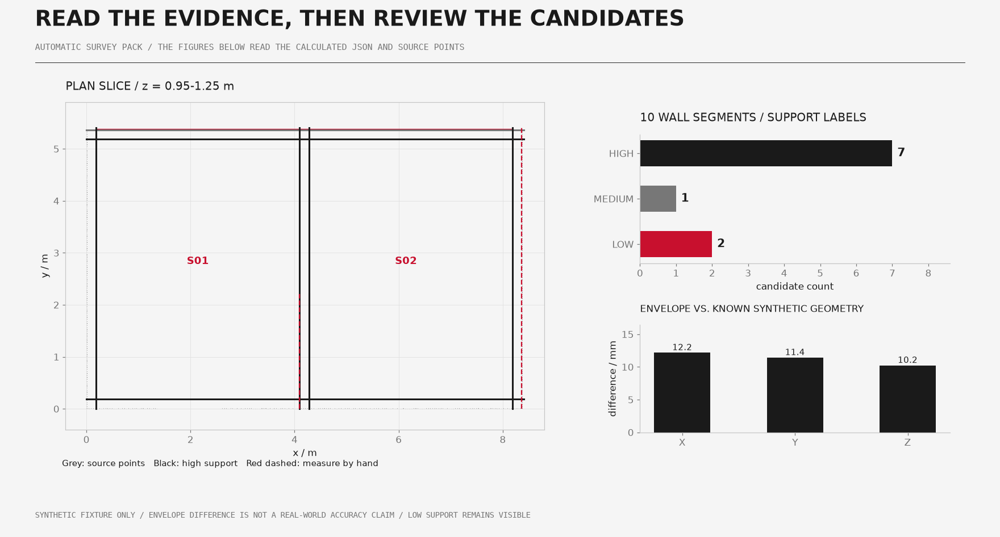 | 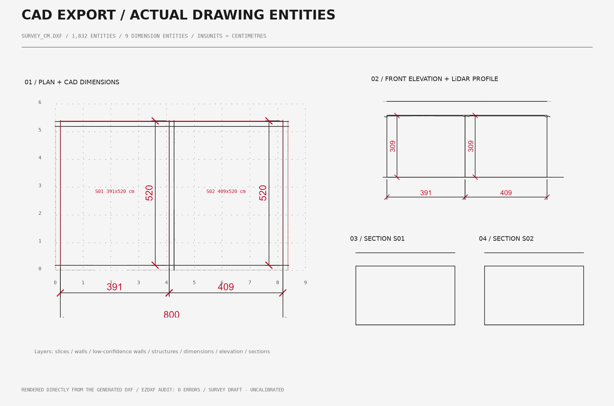 |
| **10 wall segments:** 7 HIGH, 1 MEDIUM and 2 LOW support labels. The two low-support segments remain visible for hand review. | **1,832 DXF entities:** 9 dimensions, centimetre units, and zero audit errors after reopening. The graphic is rendered from the generated DXF. |

| Check | Observed result |
|---|---:|
| Generated / processed points | 176,180 / 176,180 |
| Raw input SHA-256 before / after | Identical |
| Rigid-frame scale / determinant | 1 / +1 |
| Wall / cross-wall / partition-position / structure candidates | 10 / 3 / 3 / 2 |
| Ground-plane fit sigma | 1.23722 mm |
| Added noise XYZ RMS | 2.59838 mm |
| Exterior envelope differences X / Y / Z | 12.167 / 11.415 / 10.225 mm |
| DXF units (`$INSUNITS`) / audit errors | cm (5) / 0 |

**The fit sigma and envelope differences are not real-world survey accuracy.** The inferred bay widths are 3.91 and 4.09 m against nominal 4.00 m centreline spans. The inferred depth is 5.20 m against 5.00 m, and the eave is 3.09 m against 3.00 m. A HIGH support label can coexist with those biases.

Open the actual [synthetic DXF](docs/demo/synthetic-survey.dxf), [numerical summary](docs/demo/summary.json) and [reproduction notes](docs/demo/README.md). Doorway and window locations in the generator are known annotations; this benchmark does not validate opening detection. The interactive plan analysis is a separate workflow and can return a different candidate count.

## The method inside

```text
explicit input + axis / placement
    -> low-point ground RANSAC + SVD plane refinement
    -> metric rigid frame + horizontal direction search
    -> height bands + occupancy / projected point evidence
    -> supported wall runs + confidence / structure candidates
    -> plan + elevation + sections + dimensions / DXF layers
    -> audit + source hash + operator review
```

| Stage | What the code does |
|---|---|
| Frame | Estimates a ground plane, levels the cloud, searches horizontal directions, and records a proper rigid transform at scale 1 |
| Slices | Builds occupancy rasters over explicit height bands and a roof-height projection |
| Walls | Finds histogram peaks and supported runs, merges compatible segments, and labels support across height bands |
| Interpretation | Derives cross-wall, partition and structure candidates from the aligned evidence |
| Output | Writes sheets, numerical candidates and distinct DXF layers for source projections, geometry, low-support walls, sections, elevations and dimensions |
| Review | Preserves weak evidence and reports assumptions; the operator must check the interpretation |

See [METHOD.md](docs/METHOD.md) for exact default parameters, benchmark overrides and observed biases. [ARTICLE.md](docs/ARTICLE.md) explains why the workflow keeps drawing proposals tied to their evidence.

## Architecture

```text
viewer/      Qt desktop, project model, scan placement and workflow services
geometry/    rigid transforms, point properties, survey frame and candidates
export/      survey pack, sheets, DXF and derived drawing outputs
ingest/      generic point-cloud and CAD readers
field/       capture-depth and colour conversion helpers
examples/    mathematical generators and reproducible survey example
tests/       source preservation and synthetic regression checks
docs/        reviewed media, method notes and synthetic CAD evidence
```

This is an independently implemented Python application using PySide6, PyVista/VTK and Open3D. CloudCompare is a separate tool and workflow reference; this repository includes no CloudCompare source, icons or binaries and is not a CloudCompare source fork. External dependencies retain their original licenses.

The core workstation works without a model service. An optional local planner requires an explicitly configured endpoint. The optional standard-input/output control bridge is installed with `.[control]`; configuration and scope are described in [BUILD.md](BUILD.md).

## Files and reproduction

| File | Purpose |
|---|---|
| [examples/synthetic_survey.py](examples/synthetic_survey.py) | Generates the fictional input and invokes the application's actual survey service |
| [docs/demo/summary.json](docs/demo/summary.json) | Provenance, settings, counts, hashes, frame and comparison with known geometry |
| [docs/demo/synthetic-survey.dxf](docs/demo/synthetic-survey.dxf) | Actual synthetic plan, elevation, section and dimension entities |
| [docs/METHOD.md](docs/METHOD.md) | Algorithm, parameters and limits |
| [BUILD.md](BUILD.md) | Installation, native-window checks and package builds |
| [RELEASE_CHECKS.md](RELEASE_CHECKS.md) | Verification performed for this release |

Generated clouds and local projects are ignored by Git. Only reviewed source, license notices, documentation media and mathematical derived CAD evidence belong to this public release. The office input and its real CAD files stay private.

## Roadmap - contributions welcome

- Broaden synthetic regression cases to rotated rooms, incomplete coverage, curved walls and clutter.
- Compare measurements against independently surveyed control geometry.
- Improve candidate review and confidence explanations, including openings.
- Complete and verify the currently disabled measurement and standalone export workflows.
- Verify ReCap/Revit handoff on controlled non-sensitive examples.
- Improve English UI coverage and installation guidance.

Contributions are most useful when they include a small mathematical input, expected geometry and a reproducible failure. See [AGENTS.md](AGENTS.md) for source conventions.

## Tools & Credits

| Tool | Role |
|---|---|
| Python / NumPy / SciPy | Numerical geometry and analysis |
| PySide6 / Qt | Native desktop interface |
| PyVista / PyVistaQt / VTK | Point-cloud and geometric visualization |
| Open3D | Point-cloud and derived-surface operations |
| ezdxf | CAD entity generation, reading and audit |
| Matplotlib | Survey sheets and graphs generated from calculated output |
| CloudCompare | Independent point-cloud tool and surrounding workflow reference |
| Codex | Public-source preparation, documentation and review assistance |

See [THIRD_PARTY_NOTICES.md](THIRD_PARTY_NOTICES.md) and [licenses/](licenses/) for component licenses and mandatory attribution. Tested runtime versions are in [requirements-tested.txt](requirements-tested.txt).

## License

<p align="center">
  <picture>
    <source media="(prefers-color-scheme: dark)" srcset="docs/media/cca-mark-dark.svg">
    
  </picture>
</p>

<p align="center"><a href="LICENSE"><picture>
  <source media="(prefers-color-scheme: dark)" srcset="docs/media/license-gpl3-dark.svg">
  
</picture></a></p>

CCA-owned source is licensed under [GPL-3.0-or-later](LICENSE). Preserve the license, corresponding-source obligations and third-party notices when redistributing. Dependencies retain their own copyright and license terms. See [COPYING](COPYING) for the canonical GPL text.

Copyright (c) 2026 Creative Computational Architecture - Caglar Celik Architects (CCA).
